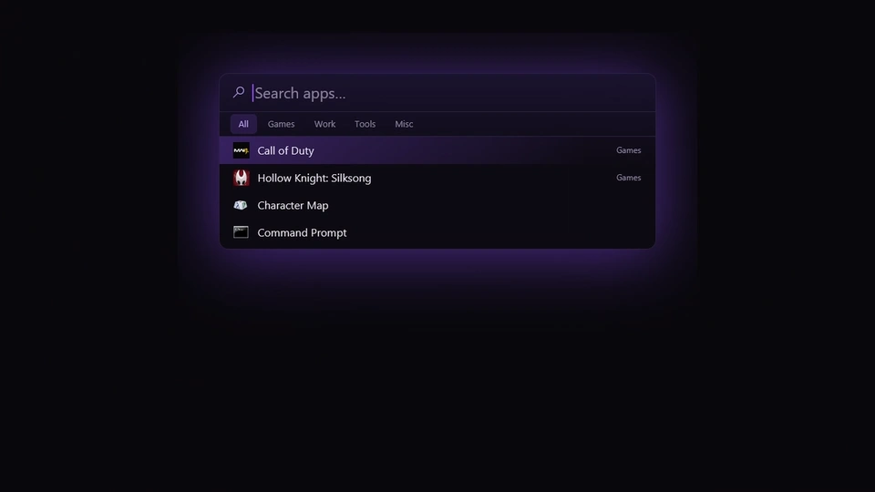

<a id="readme-top"></a>

<div align="center">


# Atray

**A keyboard launcher for Windows, for people who keep their desktop empty.**

Press a hotkey, type a few letters, hit Enter.<br>
Apps and games from the Start menu, Steam, Epic and GOG, sorted into your own categories.

[](https://www.rust-lang.org)
[](https://crates.io/crates/gpui)
[](#getting-started)
[](#readme-top)
[](LICENSE)

[Features](#features) · [Performance](#performance) · [Getting Started](#getting-started) · [Usage](#usage) · [Configuration](#configuration) · [Architecture](#architecture)

<br />

<a href="docs/demo.mp4"></a>

<sub>▶ <a href="docs/demo.mp4"><b>Watch the full video</b></a> (49 s): categories, filing, the tray panel and performance.</sub>

</div>

> [!NOTE]
> **Atray is a one-morning project.** I built it in a morning as a small utility for myself, and it is
> **experimental**: Windows only, no installer, no auto-update, rough edges expected. It is made for people
> who don't want icons on their desktop and want a fast way to open their programs. Issues and ideas are welcome.

## Why Atray

I like an empty desktop. No shortcuts, no folders, just the wallpaper. The Start menu is fine until you
have three game launchers, each with its own library, and the one game you want is buried in a list of
two hundred entries.

Atray sits in the tray and does one thing: open programs fast. `Alt+Space`, type `rai`, `Enter`, and
Rainbow Six is starting. It indexes the Start menu, Steam, Epic and GOG, learns what you open and when,
and lets you group things into categories you can jump to with a key.

## Features

- **Global hotkey.** `Alt+Space` by default (configurable) opens a search bar in the middle of the screen,
  wherever you are. The window is created once at startup and only shown or hidden, so it appears instantly.
- **Fuzzy search.** Initials and accents are handled by [`nucleo-matcher`](https://crates.io/crates/nucleo-matcher);
  prefixes rank first.
- **Every launcher in one list.** Start menu shortcuts, Steam (`libraryfolders.vdf` + manifests), Epic
  (`.item` manifests) and GOG (registry), with duplicates removed. Games launch through their own client.
- **Categories.** Tabs in the bar (`Tab`, `Ctrl+1…9`), a *Games* category filled automatically, and one key
  (`Alt+1…9` or right-click) to file the selected result. Each category can have its own global hotkey
  that opens the bar directly on it.
- **Smart suggestions.** With an empty query, Atray shows what you are likely to open now. The score decays
  over about two weeks and favors launches at the same time of day and on the same kind of day.
- **Tray panel.** Left-click the tray icon for an app grid by category and all the settings: hotkeys,
  language, start with Windows, sources, categories (rename, reorder, hotkeys) and data.
- **A real text field.** Cursor, selection, word jumps, `Ctrl+A/C/X/V`, `Ctrl+Backspace`.
- **Quiet design.** Black and violet, a soft glow around the bar, and motion only where it shows a change of
  state. Windows' *Animation effects* setting is respected.
- **Light.** One portable `.exe`, native rendering (DirectX 11 via gpui), no web view. When the bar is
  hidden, nothing is redrawn.
- **English and French**, following the Windows display language.

<p align="right">(<a href="#readme-top">back to top</a>)</p>

## Performance

Measured on a Ryzen 7 9800X3D, Windows 11, `dist` build, 141 indexed apps.

| | |
|:-|:-|
| Hotkey to rendered bar | **6.5 ms** median over 30 opens (max 7.9 ms) |
| One search, all apps | **4 µs** median (p99 9 µs) |
| Indexing Start menu, Steam, Epic and GOG | **~4 ms** (files in the OS cache) |
| Startup to tray icon | **~0.4 s** |
| Memory, waiting in the tray | **66 MB** working set (73 MB with the bar open) |
| CPU, waiting in the tray | **0.4 %** of one core (gpui wakes on each display refresh) |
| CPU, bar open and idle | **1.6 %** of one core (blinking caret) |
| Executable | **8.3 MB**, one file, icon embedded |

<p align="right">(<a href="#readme-top">back to top</a>)</p>

## Getting Started

There is no release yet: build it from source.

### Prerequisites

- **Windows 11** (Windows 10 should work, but it is untested).
- [Rust](https://www.rust-lang.org/tools/install), stable toolchain with the MSVC target (edition 2024, Rust 1.85+).
- **Visual Studio Build Tools** with the Windows SDK: gpui compiles its shaders with `fxc.exe` at build time.

The build has to run on native Windows. From WSL, `cargo check --target x86_64-pc-windows-gnu` is enough
to type-check, but it cannot produce a working binary.

### Build

```powershell
git clone https://github.com/ErwanHeschung/Atray.git
cd Atray
cargo build --profile dist
```

The executable is `target\dist\atray.exe` (8.3 MB, with the icon embedded and no console). Copy it
anywhere and run it. For a faster build while hacking, use `cargo run --release`.

> [!IMPORTANT]
> Keep the committed `Cargo.lock`. gpui 0.2.2 pulls a version of `xattr` that breaks with recent `libc`,
> so `libc` is pinned to 0.2.186. Never run a bare `cargo update`; update single crates with `-p`.

<p align="right">(<a href="#readme-top">back to top</a>)</p>

## Usage

Atray starts in the tray. Running `atray.exe` again while it is running opens the search bar.

### Search bar

| Keys | Action |
|:-|:-|
| `Alt+Space` | Open or close the bar |
| type | Search |
| `↑` `↓`, `Page Up` `Page Down`, mouse wheel | Move the selection |
| `Enter` or click | Launch |
| `Esc` or click outside | Close |
| `Tab` / `Shift+Tab` | Next / previous category |
| `Ctrl+1…9`, `Ctrl+0` | Go to category 1…9, or *All* |
| `Alt+1…9` or right-click | File the selected result in category 1…9 (press again to remove it) |
| `Ctrl+A/C/X/V`, `Ctrl+←/→`, `Ctrl+Backspace` | Usual text editing |

### Tray icon

- **Left-click**: the panel, with an *Apps* page (grid by category) and a *Settings* page.
- **Right-click**: *Open search* and *Quit*.

Windows 11 hides new tray icons behind the `^` arrow. On first run Atray asks Windows to show its icon on
the taskbar. If you hide it afterwards, your choice is kept.

<p align="right">(<a href="#readme-top">back to top</a>)</p>

## Configuration

Everything can be set from the panel. The same settings live in a commented file,
`%APPDATA%\Atray\config.toml`, which is reloaded every time the bar opens and never overwritten while it
contains an error.

```toml
[settings]
hotkey = "Alt+Space"            # Ctrl, Alt, Shift, Super + a key: "Ctrl+Shift+K", "Alt+F1"…
language = "auto"               # auto | fr | en
start_with_windows = false
disabled_sources = []           # any of "start_menu", "steam", "epic", "gog"

[[category]]
name = "Games"
games = true                    # every Steam, Epic and GOG game
hotkey = "Alt+Shift+1"          # opens the bar on this category

[[category]]
name = "Work"
items = ["…"]                   # item ids, listed by `cargo run -p atray-core --example scan`
```

Launch history is kept locally in `%APPDATA%\Atray\history.jsonl`, one line per launch, and can be
cleared from the panel. Nothing leaves your machine.

<p align="right">(<a href="#readme-top">back to top</a>)</p>

## Architecture

```
atray/
├── core/   atray-core: items, sources, search, history, config. No UI, testable anywhere.
│   └── src/sources/   start_menu · steam · epic · gog
└── app/    atray: the Windows binary
    └── src/
        ├── main.rs              windows and event loop wiring
        ├── ui.rs                search bar
        ├── panel.rs             tray panel (apps + settings)
        ├── field.rs             single-line text field
        ├── slide.rs, theme.rs   motion helpers and design tokens
        └── platform/windows.rs  hotkeys, tray, show/hide, icons, autostart
```

- **One thread.** `global-hotkey` and `tray-icon` are created on gpui's main thread, so gpui's own Win32
  message loop delivers their messages. Their events reach the UI through a single channel.
- **Ranking.** Search score = fuzzy score + 8 · ln(1 + usage). Usage = Σ e^(−age / 14 days) ·
  (1 + 0.5 if within an hour of the same time of day + 0.3 if same kind of day).
- **Icons** are extracted from the shell in the background and cached in memory.

Working notes, measurements and the gpui and Windows quirks met along the way are in
[docs/DEVLOG.md](docs/DEVLOG.md) (in French).

### Development

```bash
cargo test -p atray-core                    # search, parsers, scoring, config
cargo run -p atray-core --example scan      # what each source finds on this machine
cd app/assets && python3 make_icon.py       # rebuild atray.ico from logo.png (needs ffmpeg)
```

<p align="right">(<a href="#readme-top">back to top</a>)</p>

## Known Limitations

- Windows only. The core is portable, but the app layer has only a Windows backend.
- The search field has no IME or dead-key support.
- The bar opens on the primary display.
- Long names on panel tiles are clipped on the second line rather than ending with "…".

## License

Distributed under the MIT License. See [LICENSE](LICENSE).

<p align="right">(<a href="#readme-top">back to top</a>)</p>
